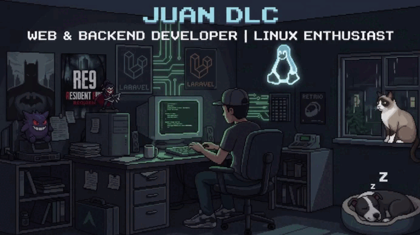

  

<h1 align="center">👋 Hello, I'm JuanDlc!</h1>

  <b>"Si funciona en producción y corre en Linux, es arte."</b>
   
  Web and Backend Developer & Linux Enthusiast

  <a href="mailto:juanalbertodlc1@gmail.com">
    <kbd>✉️ Contact Me (Gmail)</kbd>
  </a>
  &nbsp;
  <kbd>🐧 OS: | Arch | Debian</kbd>

 

<h2 align="center">⚡ Tech Stack & Ecosystem</h2>

<table align="center" width="100%">
  <tr>
    <td width="55%" align="center" valign="top">
      <h3>🌐 Web, Backend & Databases</h3>
       
      

        
        &nbsp;&nbsp;
        
        &nbsp;&nbsp;
        
        &nbsp;&nbsp;
        
        &nbsp;&nbsp;
        
        &nbsp;&nbsp;
        
        &nbsp;&nbsp;
        
      

      

        
        &nbsp;&nbsp;
        
      

      

        <kbd>JS</kbd> <kbd>TS</kbd> <kbd>PHP</kbd> <kbd>Laravel</kbd> <kbd>HTML5</kbd> <kbd>CSS3</kbd> <kbd>Bootstrap</kbd> <kbd>MySQL</kbd> <kbd>MariaDB</kbd>
      

    </td>
    <td width="45%" align="center" valign="top">
      <h3>🐧 Linux, Shell & Software</h3>
       
      

        
        &nbsp;&nbsp;
        
        &nbsp;&nbsp;
        
        &nbsp;&nbsp;
        
        &nbsp;&nbsp;
        
      

       
      

        <kbd>Arch Linux</kbd> <kbd>Debian</kbd> <kbd>Bash / Shell</kbd> <kbd>VS Code</kbd>
      

    </td>
  </tr>
</table>

 

  🚀 Siempre en la terminal | Desarrollando soluciones desde el backend.

